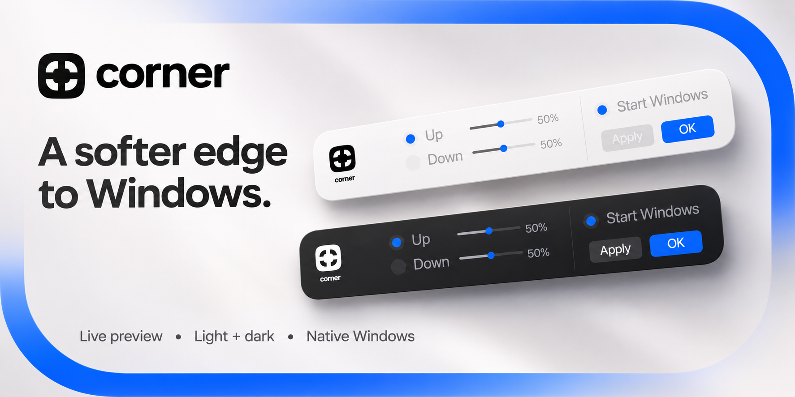
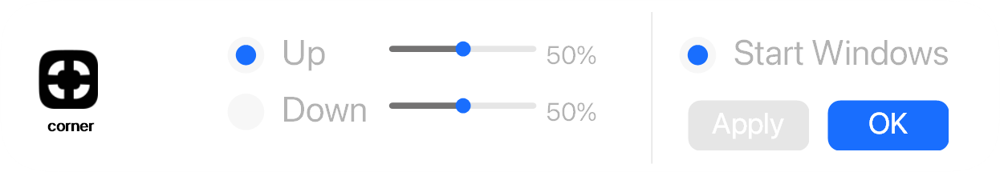
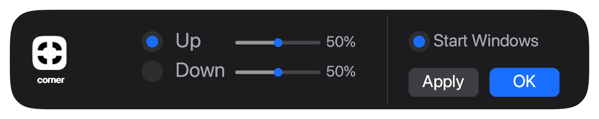
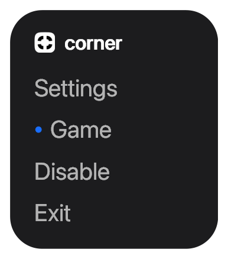
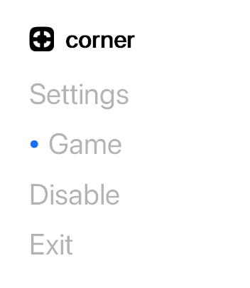

<p align="center">
  
</p>

<p align="center">
  <strong>A small native utility for a softer-looking Windows desktop.</strong><br>
  Round the top, the bottom, or all four corners of your screen.
</p>

<p align="center">
  <a href="https://github.com/unioneon/corner/releases/download/v1.3.1/corner-1.3.1-Setup-x64.exe"></a>
  &nbsp;
  <a href="https://github.com/unioneon/corner/releases/download/v1.3.1/corner-1.3.1-Portable-x64.zip"></a>
</p>

<p align="center">
  Windows 10 / 11 · x64 · Native C++ / Win32 · MIT licensed<br>
  <a href="https://github.com/unioneon/corner/releases">Releases</a> ·
  <a href="https://github.com/unioneon/corner/issues">Report an issue</a> ·
  <a href="docs/README.ru.md">Русский</a>
</p>

## Small controls. A visible difference.

**corner adds smooth, click-through masks to your display corners.**
Adjust the upper and lower pairs independently, preview the result as you
move a slider, and keep your preferred look with Apply. Close the settings
window and corner stays quietly in the system tray.

| | What you get |
|---|---|
| **Up / Down** | Toggle the two pairs independently. Drag either slider from 0 to 100%; 0% switches that pair off. |
| **Live preview** | Changes appear on the desktop immediately. Apply saves them; OK closes and discards changes made since the last Apply. |
| **Light + dark** | A compact settings window and tray menu, with smooth window edges and your choice of appearance. |
| **Black or white** | Match the corner masks to your screen surround. Click the corner logo to change color and theme. |
| **Quiet by design** | Native Win32, event-driven rendering, no animation loop or idle polling; Game checks run only during active fullscreen. |
| **Ready at sign-in** | Start Windows controls the current user's sign-in task. A waiting supervisor restores a crashed renderer. |
| **Click-through masks** | The decorative corners don't intercept clicks or activate themselves. |
| **Capture-aware** | The masks request exclusion from supported Windows capture APIs. The settings window remains capturable. |
| **Game Mode** | Click **Game** in the tray menu. A blue dot means enabled; click again to switch it off. Keeps corners enabled in fullscreen and strengthens overlay ordering while a fullscreen window is active. |
| **Above Start** | Setup automatically configures a locally signed UIAccess renderer to keep corners above Start and the taskbar. Administrator approval is required during installation. |

## Multi-monitor preview

[Try the 1.4.0 preview](https://github.com/unioneon/corner/releases/tag/v1.4.0-beta.1)
for corners on every active display, with automatic layout updates and
fullscreen hiding per display. The same controls apply to all screens.

**Hardware validation is pending:** synthetic layouts and real hidden-window
checks pass, but two physical monitors were not available for testing.
[What was tested and how to verify a two-screen setup](docs/MULTI-MONITOR.md).
The main download buttons above continue to point to stable 1.3.1.

## Meet the interface

### Light



### Dark



### Game Mode

<p align="center">
  
  &nbsp;
  
</p>

*The settings images are captured from the compiled Win32 controls using
Windows print messages. The cover is stylized, AI-assisted promotional
artwork based on those captures. [Artwork details](docs/design/POSTER.md).*

## Get started

1. Install [corner Setup](https://github.com/unioneon/corner/releases/download/v1.3.1/corner-1.3.1-Setup-x64.exe),
   or extract the complete [portable ZIP](https://github.com/unioneon/corner/releases/download/v1.3.1/corner-1.3.1-Portable-x64.zip)
   and run `corner.exe`.
   Approve Windows' UAC prompt; setup handles the configuration automatically.
2. Click the tray icon and choose **Settings**. The desktop and Start menu
   shortcuts open the same window.
3. Choose **Up**, **Down**, and their percentages. Preview changes immediately.
4. Click **Apply** to save. Click **OK** to close; unsaved preview changes
   return to the last saved configuration.

Click the logo inside Settings for **Corner color → Black / White** and
**Appearance → System / Light / Dark**. **Start Windows** takes effect when
you click Apply. The tray's **Disable / Enable** entry pauses or restores the
decoration; **Exit** ends the current session without removing your sign-in
preference.

**Game Mode:** choose **Game** immediately below Settings in the tray menu.
The blue dot indicates that it is enabled. Your choice survives restarts.
The new mode and corners with Start open were tested on the developer's
Windows system; the user also confirmed that corners remained visible in games.
This is not a compatibility guarantee for every game or anti-cheat system.

> [!IMPORTANT]
> **Why approve UAC during installation?** Windows needs administrator approval
> to install corner's protected component in Program Files and configure its
> local trusted code-signing certificate. **This keeps the corners visible above
> Start and the taskbar.** Setup does this automatically; there is no extra mode
> to configure. The key stays on your PC and is removed on uninstall.

The installed component uses UIAccess, which broadens access to other apps' UI;
Microsoft reserves it for accessibility software, so its use here is experimental.
[Signing, permissions and removal details](docs/ENHANCED.md).

## A few practical details

- **Requirements:** Windows 10 version 2004 or newer, or Windows 11; x64.
- **Displays:** stable 1.3.1 targets one screen. The 1.4.0 preview targets all active logical displays by default; `-Panel` remains available for explicit single-display selection.
- **Sizing:** 100% corresponds to a 256-pixel corner extent. Percentages are
  independent for the top and bottom, and are measured in physical pixels.
- **Fullscreen:** corners remain visible in browser video and normal borderless
  fullscreen by default. Click the logo → **Fullscreen → Show corners / Hide corners**
  to choose the behavior. Exclusive fullscreen games may bypass ordinary overlays.
  Game Mode overrides automatic fullscreen hiding while enabled. Use borderless
  fullscreen for the best compatibility; true exclusive fullscreen is not guaranteed.
- **Screen capture:** exclusion depends on the Windows capture path. It is
  best-effort, not a guarantee for every recorder, driver or sharing program.
- **Virtual desktops:** experimental pinning uses an optional private COM
  interface in an isolated, time-limited helper. If unavailable, ordinary
  topmost masks continue working. Stationary behavior during every desktop
  animation is not guaranteed.
- **Shape:** the default is an approximate continuous corner, not a contour
  extracted from Apple hardware or from your physical panel.
- **Fonts:** SF Pro Display is used when available locally, with Segoe UI as
  the fallback. **No Apple font files are included in the repository or downloads.**

corner makes no network requests and contains no telemetry. Preferences stay
in `settings.ini` beside the executable. Installed copies live in
`%LOCALAPPDATA%\corner`; portable copies keep preferences in their extracted
folder. Don't run the portable app directly inside the ZIP.
Enhanced mode shares the same per-user settings; its protected executable does
not store preferences in Program Files. Game Mode's extra layer check runs only
while an enabled fullscreen window is active; there is no idle game timer.

## Manage it with a script

The installer and portable package include `manage.ps1`:

```powershell
.\manage.ps1 settings
.\manage.ps1 status
.\manage.ps1 restart
.\manage.ps1 stop
.\manage.ps1 uninstall
```

`install` creates a per-user installation and sign-in task. `stop` also disables
the task until `restart`; uninstallation removes known application files and
shortcuts while leaving unknown files alone. A renderer crash normally
recovers after a two-second backoff. A crash of the supervisor itself uses
Task Scheduler's one-minute retry interval, if the sign-in task is enabled.

## Build

Use a MinGW-w64 GCC toolchain on Windows and PowerShell:

```powershell
.\build.ps1 -Compiler C:\w64devkit\bin\g++.exe
.\tests\smoke.ps1
```

The compiler directory must include `windres.exe`. Output: `bin\corner.exe`.
Build the installer and portable package with `scripts\release.ps1` and
Inno Setup 6 or 7. [Development notes](docs/DEVELOPMENT.md).

## License

[MIT](LICENSE). Original icon and UI concept by **unioneon**.
See [third-party notices](THIRD_PARTY_NOTICES.md) for runtime, fonts and artwork.
