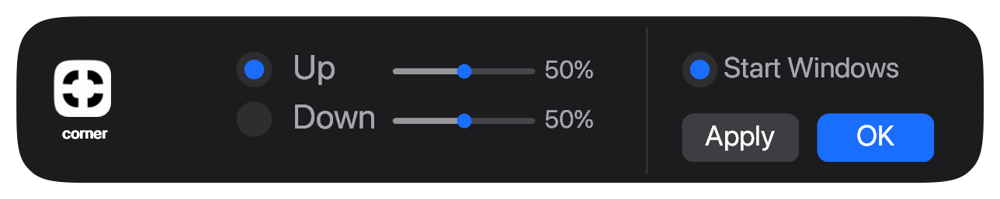

# corner

**Плавные углы для рабочего стола Windows.** Верх и низ настраиваются отдельно,
результат виден сразу, а после закрытия настроек утилита остаётся в трее.

[Скачать установщик](https://github.com/unioneon/corner/releases/download/v1.3.0/corner-1.3.0-Setup-x64.exe) ·
[Portable ZIP](https://github.com/unioneon/corner/releases/download/v1.3.0/corner-1.3.0-Portable-x64.zip) ·
[English](../README.md)

- **Up / Down** — верхние и нижние углы. Повторное нажатие отключает пару.
- Ползунки независимы; **0%** отключает соответствующую пару.
- **Apply** сохраняет предпросмотр и оставляет окно открытым.
- **OK** закрывает окно и отменяет изменения после последнего Apply.
- **Start Windows** — автозапуск при входе текущего пользователя; применяется по Apply.
- Нажатие на логотип открывает выбор чёрного/белого цвета углов и темы.
- Меню трея: **Settings**, **Game**, **Disable / Enable**, **Exit**.
- **Game** — игровой режим. Синяя точка означает, что он включён; повторное нажатие отключает режим.
- При установке автоматически настраивается отображение углов поверх «Пуска» и панели задач.

> [!IMPORTANT]
> **Зачем подтверждать UAC при установке?** Windows запрашивает права администратора,
> чтобы установить защищённый компонент corner в Program Files и настроить локальный
> доверенный сертификат подписи. **Это позволяет углам оставаться видимыми поверх
> меню «Пуск» и панели задач.** Установщик всё настраивает автоматически.
> Закрытый ключ остаётся на вашем компьютере; при удалении удаляются компонент, сертификат и ключ.

Игровой режим и работа с открытым «Пуском» проверены на компьютере разработчика;
пользователь также подтвердил работу в играх. Полная совместимость с каждой игрой
и настоящим эксклюзивным полноэкранным режимом не гарантируется.

Windows 10 2004+ или Windows 11, x64. Маски пропускают клики. В полном экране углы остаются видны по умолчанию;
поведение выбирается через логотип → Fullscreen → Show / Hide corners. Форма приближённая; совпадение с контуром
Apple не заявляется. Исключение из записи зависит от способа захвата Windows.
Поведение в анимациях виртуальных столов может различаться по версии ОС.

Приложение не обращается к сети. Настройки находятся в `settings.ini` рядом
с EXE. SF Pro используется, если доступен локально; запасной шрифт — Segoe UI.
Файлы шрифтов Apple не распространяются.
